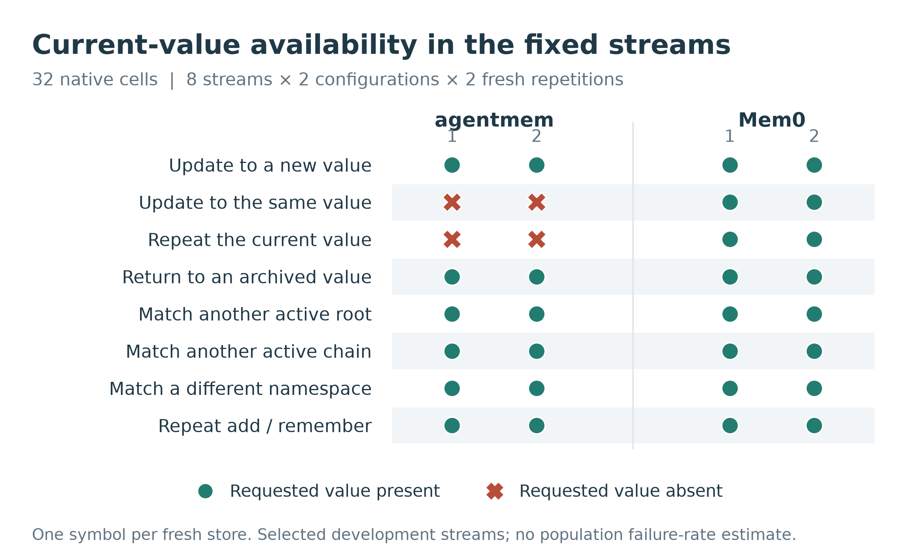
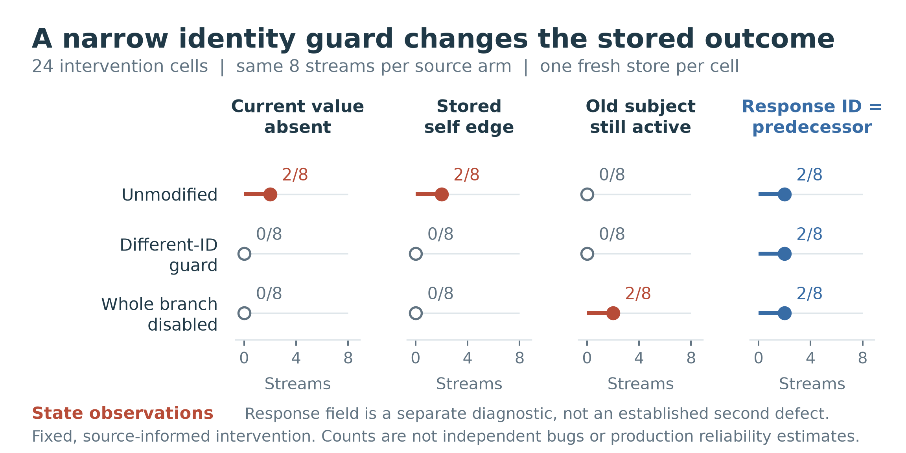
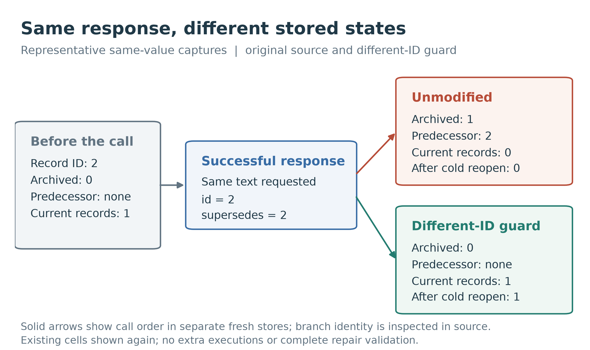

# Native memory identity study

Reproducible synthetic data, native storage captures, analysis code, and vector
figures for a bounded study of content deduplication and version identity.

In the pinned agentmem configuration, a successful update to the current value
can archive the same record that deduplication returns. The requested current
value then disappears from public reads, physical active records, and reads
after reopening the store. A controlled source intervention isolates the
identifier-equality branch in the eight selected operation streams.

This is a source-informed development case study. The contribution is an
executable native witness and a bounded mechanism intervention. It is not a
new general testing principle, a reliability ranking, or a population estimate.



## What is included

| Path | Content |
| --- | --- |
| `data/benign/` | All 32 original native cells, steps, SQLite/Qdrant stores, source snapshot, frozen protocol, instrument, environment, and logs |
| `data/intervention/` | All 24 separate source-intervention cells, stores, three source variants, exact patches, and worker logs |
| `results/` | Original generated per-cell tables, binding records, and analyses |
| `research/` | Executable study instruments, analyzers, meaningful measurement tests, and plotting source |
| `figures/` | Three figures as PDF, editable SVG, and 360 DPI PNG; atlas, captions, alt text, data, and visual-review record |
| `scripts/reproduce.py` | Manifest validation, offline reanalysis, figure regeneration, and fresh native execution |
| `PROVENANCE.json` | Export lineage, source versions, byte-preserved file hashes, and distribution amendment |
| `RELEASE_MANIFEST.json` | SHA-256 of each release file, excluding the manifest itself |

The synthetic vocabulary contains only four literal strings:
`memoryprobe preference blue`, `memoryprobe preference green`,
`memoryprobe preference red`, and `memoryprobe unrelated keep`.
There are no external benchmark records, human annotations, model responses,
or provider credentials in this release.

## Observed results

The original matrix is eight selected streams, two native configurations,
and two fresh repetitions, for **32 cells**. The two configurations use different
interfaces; their history representations are not interchangeable.

| Original configuration | Cells | Requested current value unavailable |
| --- | ---: | ---: |
| agentmem-lite 0.3.0, pinned source | 16 | 4 |
| Mem0 2.2.1, local Qdrant and SQLite history | 16 | 0 |

The four affected agentmem cells are two known streams (`same_value` and
`repeat_current_value`) repeated twice. They represent one observed failure
family, not four independent bugs. Both repetitions have matching outcome
signatures. Mem0 predecessor-graph properties are **not applicable**; its zero
current-loss count is not a graph-validation result.

The intervention is a **separate 24-cell matrix**, with eight known streams
per source arm and one fresh store per cell:

| Source arm | Current-loss cells | Stored self edges | Old subject active with different returned ID | Response ID equals predecessor |
| --- | ---: | ---: | ---: | ---: |
| Unmodified | 2 | 2 | 0 | 2 |
| Unequal-ID guard | 0 | 0 | 0 | 2 |
| Deduplication branch disabled | 0 | 0 | 2 | 2 |

The unequal-ID guard changes only the branch condition. Disabling the entire
branch is a mechanism control, not a proposed repair. The response's
self-valued predecessor remains under all three arms; that field alone is
not classified as an additional defect because an independent no-op response
contract has not been established. The guard has not been validated as a
complete production repair.



## Reproduce

Use Python 3.12. No API key, model service, human labels, or embedding service is
required. All commands refuse existing output directories. Change the output
name for another run.

First verify every bound file with the Python standard library:

```sh
python3 -B scripts/reproduce.py --mode verify
```

Reanalyze every released cell and run the measurement tests, without installing
any dependencies or calling the native memory libraries:

```sh
python3 -B scripts/reproduce.py --mode analyze --out outputs/analysis_01
```

Regenerate the figures with the pinned rendering dependencies. With `uv`:

```sh
uv run --no-project --python 3.12 \
  --with-requirements requirements-figures.txt \
  python -B scripts/reproduce.py --mode figures --out outputs/figures_01
```

This reopens all 56 cell snapshots and compares all nine standalone figure
exports with the released files. Byte identity is checked with the recorded
renderer environment; another platform or font stack can require explicit
render review. `QUALITY_REPORT.json` records the pre-visual stage, while the
later `VISUAL_REVIEW.json` records the completed inspection.

Execute both finite matrices in fresh stores with the native dependencies:

```sh
uv run --no-project --python 3.12 \
  --with-requirements requirements-native.txt \
  python -B scripts/reproduce.py --mode native --out outputs/native_01
```

Dependency installation may use the network. Add `--offline` to `uv run` when
the requirements are already cached. Native workers block network access and
disable telemetry; Mem0 uses a static local eight-dimensional embedding double
and `infer=False`, while agentmem has no embedding function. The runner checks
the exact native source binding before execution and compares the fresh
per-cell outcome tables with the released tables. IDs, timestamps, storage
bytes, and manifests can differ across fresh runs.

Recorded environment: Python 3.12.14, macOS arm64, SQLite 3.53.1,
sqlite-vec 0.1.6, qdrant-client 1.19.1. Renderer: Matplotlib 3.11.2,
NumPy 2.5.3, pypdf 6.19.0. See the raw environment and requirements files.

## Scope and limitations

- Streams were selected after inspecting the native source. They are development
  cases, not a held-out benchmark or a representative workload.
- Repetitions and source variants are not independent implementations. Existing
  executions were performed by the same owner on the same workstation.
- No statistical significance test, deployment failure rate, semantic memory
  quality, diagnostic superiority, or general system ranking is established.
- HTTP, full-agent behavior, concurrent updates, crashes, and distributed
  transactions are outside these experiments.
- These artifacts support a bounded mechanism observation. Exact-case priority,
  publication significance, and journal acceptance are not established by
  successful reproduction or public release.
- The coauthored manuscript remains a separate author-review draft. This is a
  code/data release, not a journal submission or a statement of all-author
  manuscript approval.



## Provenance and licensing

Pinned agentmem source:
[`oxgeneral/agentmem@14a5b85`](https://github.com/oxgeneral/agentmem/tree/14a5b85b143285029fb72958424d903d8fe4b08c).
Mem0 dependency: [`mem0ai` 2.2.1](https://pypi.org/project/mem0ai/2.2.1/), with
the exact captured `Memory` source hash checked by the instrument.

Author-created software is MIT licensed. Author-created synthetic fixtures,
measurements, tables, and figures are CC BY 4.0. Vendored agentmem files retain
their MIT notice; captured Mem0 source retains Apache-2.0 terms. See
`LICENSE-DATA.md` and `THIRD_PARTY_NOTICES.md` for file boundaries.

Historical protocols and captured READMEs retain their original private-stage
wording verbatim. The separately authorized public export changes distribution
only. No criterion, outcome, source arm, or historical manifest was rewritten.
An upstream test contains an upstream Linux fixture path; it is preserved as
licensed public source, is not a research-workstation path, and is not executed
by this study.

Use `CITATION.cff` to cite the artifact. No paper DOI is claimed.
